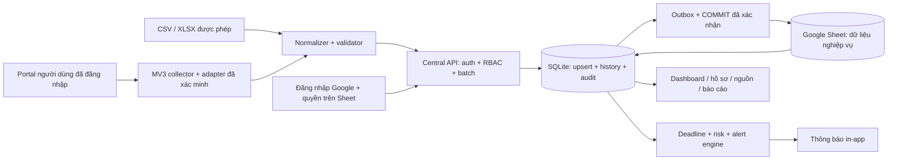

# Báo cáo triển khai GS-TTHC

Ngày kiểm tra: **05/10/2026** (giờ Việt Nam). Đây là bản trung tâm chạy local với API/database thật và collector core; chưa hoàn tất nghiệm thu portal trong phiên đăng nhập thật hoặc môi trường production.

**Bổ sung theo yêu cầu Google Sheet:** chế độ đăng nhập Google qua OAuth/OIDC, email đã xác minh đối chiếu tab `Permissions`; quản trị đầu tiên `ithoangcuong@gmail.com`. Trong `DATA_BACKEND=google_sheets`, workbook `18AjwLQla8V88ANBKZHXHwNhmkrHvvgld3v3HeLna7BU` là nơi lưu dữ liệu nghiệp vụ, SQLite là bản đệm cùng hàng đợi chờ ghi. Backend chỉ trả thành công sau xác nhận COMMIT từ Sheet. Session/token/khóa xác thực được giữ riêng trên máy chủ. Chi tiết thiết lập và giới hạn: [GOOGLE_SHEETS.md](GOOGLE_SHEETS.md). Chưa kết nối workbook hoặc đăng nhập Google thật vì chưa có service account và OAuth credentials.

## 1. Kiến trúc và audit

Thư mục đầu vào trống, không Git/source/framework/database/migration/chức năng cũ. Không có build cũ để sửa hoặc module cũ để thay thế. Chọn Node.js24 + SQLite tích hợp để chạy không cần runtime dependency/npm/network. Giao diện ES modules thuần, CSS responsive; model/engine strict TypeScript. Dev dependencies khóa bằng package-lock: TypeScript, @types/node, playwright-core.

Controller HTTP, database/migrations, auth/scope, cases/sync/query, typed engine, parser file và notification adapter tách module. Nguồn registry dùng chung giữa server và extension. Engine đánh giá từ timestamp chính thức, không từ AI/countdown. UI không tải toàn bộ hồ sơ; backend filter/aggregate/pagination bằng SQL.

## 2. File tạo mới

Tất cả file là mới vì thư mục đầu vào trống. Danh sách đầy đủ file source/config/docs/test ở [FILES.md](FILES.md). Các nhóm chính:

- `server/`: app, main, cli, auth, database, cases, engine.ts, import, seed, notifications, migration SQL.
- `shared/`: model TypeScript, registry 11 nguồn và normalization/validation.
- `web/`: app.js, pages.js, ui.js, index.html, styles.css, scales.css.
- `extension/`: manifest, service worker, content module/bundle, adapter base/registry/TPHCM, API client, popup/options, shared modules và build.
- `tests/`: collector, engine, import, query, server, web.
- `scripts/`: cú pháp/rules, build, Chrome smoke và benchmark.
- `docs/`, `deploy/`, README, package/lock, tsconfig, .env.example và .gitignore.

`extension/content/collector.js` và `extension/shared/*` được sinh từ module source bằng `node extension/build.mjs`. Sửa `collector.mjs`/module liên quan rồi build lại. `dist/` là bản đóng gói có thể chạy với Node24; không chứa database hay secret.

## 3. File cũ chỉnh sửa

Không có file cũ trong lần audit. Trong quá trình triển khai, các file mới đã được sửa để đáp ứng kiểm thử (status sparse/canonical, lịch sử ngày hẹn, mask dữ liệu, giới hạn token, CSV/XLSX và UI). Không có dữ liệu/source của người dùng bị ghi đè hoặc xóa.

## 4. Schema và migration

`server/migrations/001_initial.sql`: schema_migrations; users; sessions; collector_tokens; source_systems; source_field_mappings; source_status_mappings; agencies; departments; officers; procedures; cases; case_aliases; case_history; sync_jobs; alert_rules; alerts; alert_history; notifications; system_settings; audit_logs.

`002_google_identity.sql` thêm Google subject/email duy nhất cho users. `003_sheet_store.sql` thêm outbox, batch và trạng thái bản đệm; triggers sinh từ danh sách bảng nghiệp vụ, loại passwordHash/session/token. Nhật ký `GS_Data` có checksum, dữ liệu chia ô và COMMIT; đọc lại để xác nhận ghi, chống ghi lặp sau timeout và khôi phục vào bản đệm mới.

Các trường chuẩn đầy đủ lưu trong JSON `cases.data`; các trường thường filter/aggregate có cột và index riêng. `cases.evaluation` giữ kết quả engine; `originalDueAt` không bị ghi đè bằng sync mới. Case history ghi diff field, loại thay đổi, actor, sync job và timestamp; một bảng lịch sử thay các bảng riêng từng loại. Timestamp canonical UTC ISO; created/updated/job timestamps dùng epoch ms. Mapping/rules/settings lưu JSON có validator. SQLite foreign keys/WAL/prepared statements, migration transaction và version, kiểm thử rerun không mất cấu hình.

## 5. API endpoints

Các endpoint dưới đây cần session trung tâm, trừ login/health; collector sync chỉ nhận bearer token riêng. Mutations dùng session cần `X-CSRF-Token`.

| Method | Endpoint | Kết quả/quyền |
|---|---|---|
| GET | `/api/health` | Liveness public |
| GET | `/api/auth/config` | Chế độ đăng nhập và lưu dữ liệu, không chứa bí mật |
| GET | `/api/auth/google/start` | OAuth state gắn cookie, nonce và PKCE |
| GET | `/api/auth/google/callback` | Xác minh Google identity + quyền Sheet, tạo session |
| POST | `/api/admin/permissions/refresh` | SYSTEM_ADMIN + CSRF, đọc lại toàn bảng quyền và thu hồi quyền cũ |
| POST | `/api/auth/login` | Cookie HttpOnly, CSRF và user công khai |
| GET | `/api/auth/me` | User/scope, CSRF, demoMode |
| POST | `/api/auth/logout` | Xóa session hiện tại + thu hồi collector tokens của user |
| POST | `/api/collector/tokens` | Token ngắn hạn; VIEWER bị chặn |
| POST | `/api/collector/sync` | Normalize/validate/scope/upsert từng dòng, idempotent batch |
| GET | `/api/cases` | Filter/search/sort/pagination server, scope enforce |
| GET | `/api/cases/:id` | Hồ sơ, history, alert trong scope |
| GET | `/api/dashboard` | Metrics, nhóm nguồn/cơ quan/phòng/cán bộ/thủ tục, priority |
| GET | `/api/alerts` | Cảnh báo trong scope, pagination |
| POST | `/api/alerts/:id/acknowledge` | Xác nhận tiếp nhận, có audit; VIEWER bị chặn |
| GET | `/api/sources`, `/api/sources/:id` | Source, mapping, health và jobs theo quyền |
| PATCH | `/api/sources/:id` | Enable/disable; SYSTEM_ADMIN hoặc CENTRAL_ADMIN toàn nguồn |
| GET | `/api/catalogs` | Catalog từ hồ sơ trong scope, enums/schema |
| POST | `/api/import/preview` | Tối đa20 dòng xem trước, file đã parse/kiểm giới hạn |
| POST | `/api/import/validate` | Mapping + validation từng dòng |
| POST | `/api/import/commit` | Upsert partial successes; VIEWER bị chặn |
| GET | `/api/reports` | Tổng hợp theo bộ lọc/kỳ thời gian |
| GET | `/api/reports/export?format=csv\|xlsx` | File trong scope, tối đa10.000 dòng, audit |
| GET | `/api/settings` | Rule/calendar; role quản trị |
| PUT | `/api/settings/rules`, `/api/settings/calendar` | SYSTEM_ADMIN, validation + audit |
| GET/POST | `/api/admin/users` | List/create, SYSTEM_ADMIN |
| PATCH | `/api/admin/users/:id` | Scope/role/active; thu hồi sessions/tokens; không tự hạ quyền |
| GET | `/api/admin/roles` | Vai trò/quyền, SYSTEM_ADMIN |
| GET | `/api/audit-logs` | Audit pagination, SYSTEM_ADMIN |
| GET | `/api/sync-jobs` | Jobs source được cấp và actor own khi không SYSTEM_ADMIN |
| GET | `/api/notifications` | Thông báo in-app theo scope hồ sơ |

Case filters: sourceSystem, agencyId, departmentId, officerId, procedureCode, normalizedStatus, alertLevel, risk=high, overdue=true, needsReview=true, completionTiming=onTime/late, q, receivedFrom/To, dueFrom/To, sort/order, page/pageSize. Bộ lọc Missing dùng cho nhóm chưa có phân công. LIMIT<=100 mỗi trang. Query SQL không ghép giá trị người dùng vào SQL.

## 6. Routes frontend

`/login`, `/dashboard`, `/cases`, `/cases/:id`, `/alerts`, `/sources`, `/sources/:id`, `/agencies`, `/departments`, `/officers`, `/procedures`, `/import`, `/reports`, `/settings`, `/admin/users`, `/admin/roles`, `/audit-logs`, `/sync`, `/notifications`. Alias: `/imports`, `/users`, `/roles`, `/audit`. Route refresh trả SPA index. Source filter giữ qua KPI/drilldown; empty/loading/error/permission state có thông báo tiếng Việt.

## 7. Role và dữ liệu

SYSTEM_ADMIN truy cập toàn hệ thống và cấu hình toàn cục. CENTRAL_ADMIN chỉ nguồn/scope được cấp; bật/tắt cả source đòi hỏi không bị giới hạn đơn vị/cán bộ. AGENCY_LEADER có agencyId, DEPARTMENT_LEADER có departmentId, OFFICER có officerId. VIEWER đọc theo scope, che người nộp và ẩn metadata/history metadata. Tất cả role trừ SYSTEM_ADMIN cần danh sách nguồn cụ thể. Quyền được kiểm tra backend cho read/detail/dashboard/export/alerts/import/sync; không chỉ ẩn UI.

## 8. Deadline và alert rules

Ưu tiên hạn gia hạn chính thức, rồi ngày hẹn hiện tại. Giữ ngày hẹn ban đầu. `dueAt:null` là rút hạn hiện tại, chuyển review dù originalDueAt còn. Hoàn thành ON_TIME/LATE theo completedAt so với hạn; thiếu completedAt/hạn là UNKNOWN. Hủy/trả lại không sinh overdue thông thường. Trạng thái chờ/tạm dừng/unknown mặc định NEEDS_REVIEW; chỉ dùng hạn nguồn khi có cấu hình được xác nhận.

WATCH7 ngày là ngưỡng theo dõi kỹ thuật; WARNING3 ngày/HIGH_RISK1 ngày/CRITICAL_OVERDUE3 ngày lấy ví dụ yêu cầu. OVERDUE khi timestamp đã vượt hạn và còn xử lý. Cấu hình GLOBAL→SOURCE→AGENCY→PROCEDURE, cấu hình riêng ghi đè mức chung. Đây là ngưỡng thông báo, không định nghĩa ngày làm việc/pháp luật. Mỗi đánh giá có triggeredRule và reasons. Alert một ID/case, update/escalate/resolve với alert history; acknowledgment được giữ khi cùng mức và reset khi mức thay đổi. Notification chỉ tạo khi phát sinh/escalate/được mở lại, chống duplicate khi sync cùng mức.

Vòng nền truy vấn index nextRecalculationAt, tối đa500 rows mỗi lượt, nhường event loop giữa lượt. Khi đổi rule, đánh dấu tính lại toàn bộ theo batch. Read API quan trọng cũng tính lại các hồ sơ đến mốc; với khối lượng lớn có độ trễ trong khi quét, cần load test hạ tầng thật.

## 9. Risk

Risk theo rule, 0–100; cấu hình mặc định35 điểm gần ngưỡng WARNING,70 khi gần hạn HIGH_RISK. Khi có số bước còn lại và gần hạn, thêm5/bước tối đa20. Khi nguồn cung cấp averageStepSeconds và timestamp bước vượt trung bình, thêm15. Clamp100. Overdue risk100. Không có dữ liệu workflow/average thì không tạo lý do giả. Trọng số sửa qua API; UI hiển thị điểm, lý do và rule.

## 10–12. Source adapters và mức hoạt động

11 nguồn đã đăng ký; MOC có thêm alias hostname/URL ví dụ người dùng cung cấp. TP.HCM PARTIAL: normalization sample và DOM header parser cấu hình. Mười nguồn WAITING_FOR_SAMPLE: skeleton/interface độc lập, không endpoint/selector tự đoán. **Chưa có adapter nào đã được kiểm chứng live.** Registry/host detection, normalize, validators, synthetic DOM test và transport central đã kiểm thử. Bảng chi tiết bằng chứng, nhu cầu mẫu và thêm nguồn ở [ADAPTERS.md](ADAPTERS.md).

## 13. Extension

Manifest V3, exact portal host permissions (11 nguồn,12 hostname), content ISOLATED, worker, popup/options, session storage cho token trung tâm, adapter registry. Cần login marker độc lập và selector/URL đã xác minh mới đọc bảng. Chỉ trang đang hiển thị, manual sync; không tự giả định phân trang, không đọc portal sessions, không API probing. Batch100, UUID batch ổn định khi retry, timeout/backoff, resumable pending job bằng alarms/session. Token chỉ dùng central sync. Chưa có JSON/XHR extractor được xác minh nên không giả vờ ưu tiên transport cấu trúc đã biết.

## 14. Test coverage chính

**64 tests pass**: collector18, engine10, import17, query2, API/server10, web7. Đây là số test chức năng, chưa đo phần trăm line coverage. Bao phủ timezone/boundary/completion/extension/withdrawal/pause/risk/calendar; canonical/sparse/unknown status; credentials/metadata/URL; selector/login fail-closed/sender; timeout/retry; CSV/XML/ZIP/XLSX/date-only/formula;6 role scope trên list/detail/export/alerts/catalog/source; partial batch/idempotence/stale/history/aliases; CSRF/logout/revocation; migrations; background due crossing; KPI/group links/XSS/render.

Chrome headless thật qua Playwright: login, demo banner, source MOC filter, risk KPI đúng1 hồ sơ, case detail,14 routes chính, CSV wizard tạo record, viewport390px không tràn trang, mở/đóng menu, không JavaScript exception. Screenshot local `data/preview/dashboard.png`, `mobile.png`. Browser dùng database in-memory riêng, không hồ sơ thật. Chưa kiểm thử extension cài thực với portal đã đăng nhập.

Benchmark100.000 hồ sơ tổng hợp in-memory, một process: insert fixture1162ms; source page25 rows22ms; dashboard50.000 rows610ms; query plan dùng index source. Số liệu lần chạy05/10/2026 trên máy này, không SLA sản phẩm, không concurrent load test/throughput sync. Dữ liệu benchmark không persist và không giả là portal thật.

## 15. Build status

`npm run check` PASS: syntax/security rules, strict typecheck cho model/engine,64 unit/integration/render tests, extension bundle, dist app. `npm run test:browser` PASS. `npm run benchmark` với RECORD_COUNT=100000 PASS. Runtime Node24 đã chạy server local phục vụ Chrome. Bản `dist/` đã được khởi tạo bằng CLI trên database tạm, tạo admin ngẫu nhiên, chạy server/login thành công, xác nhận database thật rỗng, tạo SQLite backup và kiểm tra integrity_check=ok; dừng server kiểm thử và dọn fixture sau kiểm tra. Build output `dist/`; chưa test Docker vì môi trường không có Docker.

## 16–17. Chạy và deploy

`npm install` → `npm run demo`: database demo riêng132 hồ sơ; mật khẩu ngẫu nhiên in lần tạo đầu. Dữ liệu thật: copy .env.example→.env, `npm run setup`, `npm start`; database thật rỗng, không seed. Mở http://localhost:3000. Hướng dẫn chi tiết [README](../README.md).

Production: `npm run build`, chuyển dist đến máy Node24, persistent disk, setup admin, NODE_ENV=production, APP_ORIGIN HTTPS thật, reverse proxy. Backup API SQLite và restore drill. [Deploy](../deploy/README.md), [security](SECURITY.md). Chưa publish/deploy lên external service.

## 18. Thêm nguồn thứ12

Đăng ký source/host chính xác; adapter riêng/interface; sample được phép và bằng chứng login; field/status mapping; fixture/unit/error/isolation tests; cập nhật manifest qua build; test với phiên nguồn hợp lệ; chỉ enable khi xác minh. Không sửa10 adapter khác. [Quy trình đầy đủ](ADAPTERS.md).

## 19. TODO còn lại

- Mẫu DOM/JSON từ phiên hợp lệ, login marker, pagination và trạng thái nguồn; đặc biệt trang Bộ Xây dựng đã cung cấp.
- Nghiệm thu ít nhất một live authenticated adapter. Chưa có integration thật với11 cổng.
- Ngoại kênh email/SMS/Zalo/Teams/Telegram/webhook có adapter NOT_CONFIGURED, chưa gửi; cần credentials, endpoint và quy trình được cấp phép. In-app hoạt động.
- AI, PDF export, SSO/MFA, password recovery/self-service, retention automation, phân phối queue/workers và HA chưa triển khai. Không nằm trên đường chạy MVP hiện tại.
- Load test nhiều người dùng/concurrent sync, disk backup/restore drill, HTTPS/certs và Docker nghiệm thu tại hạ tầng thật. SQLite writer một process; chưa cam kết production100.000 hồ sơ đồng thời.
- ID đơn vị/cán bộ cần phạm vi source, có xung đột thì report/reject thay vì tự gộp. Khi nguồn không có ID, fallback theo source+tên cần xác minh phân công/đồng danh trước khi cấp quyền cán bộ.
- Recalculation background theo batch có độ trễ trong tải cao; cần đo/tách workers trước scale-out.
- Chưa có phần trăm line coverage hoặc đánh giá bảo mật độc lập.

## 20. Nghiệp vụ cần xác nhận

Ngày làm việc, thứ7/CN, nghỉ lễ/làm bù theo năm; cách loại trừ thời gian bổ sung/chờ/tạm dừng; ý nghĩa trả lại/hủy/hoàn thành và thời điểm completedAt ở từng portal; tính hợp lệ ngày hẹn gia hạn và thủ tục đặc biệt; ngưỡng cảnh báo và trọng số risk theo nguồn/đơn vị/thủ tục; phạm vi dữ liệu mỗi tài khoản và chính sách mask/retention/backup. Không tự xác định quy định pháp lý từ yêu cầu “hỗ trợ luôn”. Các trường hợp thiếu căn cứ giữ NEEDS_REVIEW.
